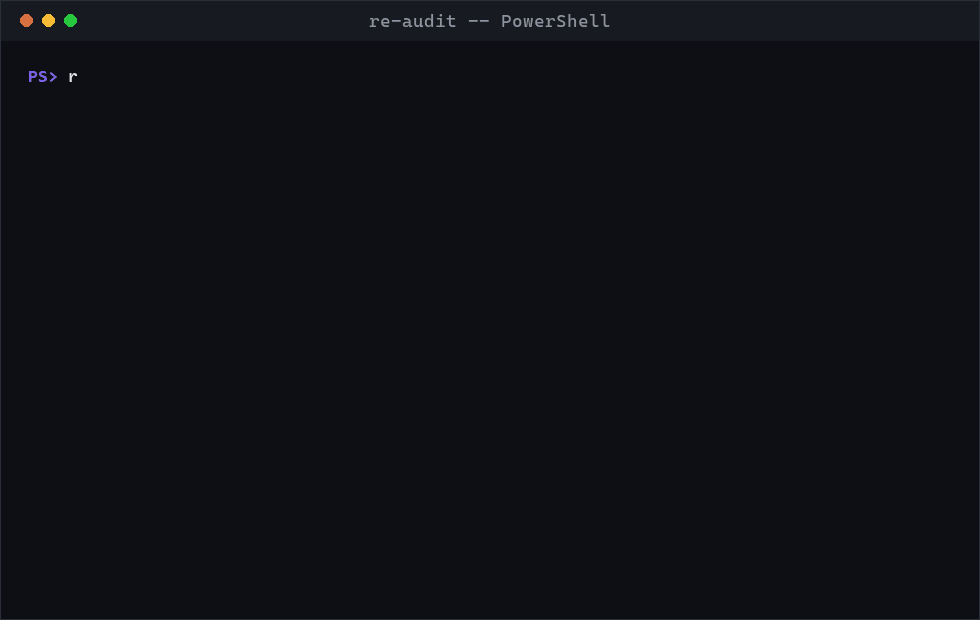
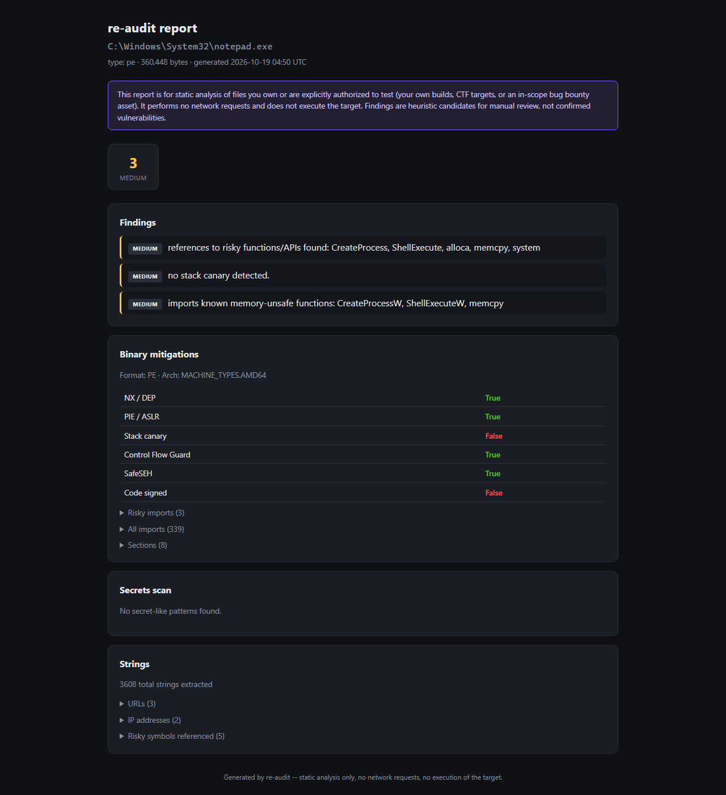

# re-audit

[English](README.md) | **한국어**

[](https://github.com/TLSRUF/re-audit/actions/workflows/ci.yml)
[](LICENSE)
[](https://m8ven.ai/mcp/tlsruf-re-audit-ark0u6?s=readme)

정적 분석 기반으로 리버스 엔지니어링을 보조하는 취약점 트리아지 도구입니다.
CLI로도, AI 에이전트(Claude Code 등)가 직접 조작할 수 있는 MCP 서버로도 씁니다.

**Ghidra 기반 MCP 서버 대신 이걸 쓰는 이유:** Ghidra/Java 설치도, 프로젝트
데이터베이스도, 스크립팅할 GUI도 필요 없습니다. `pip install re-audit` 한
줄이면 몇 초 안에 결과가 나옵니다. 대신 Ghidra 수준의 완전한 디컴파일
깊이는 포기한 거라, 가볍고 스크립트로 돌리기 좋고 CI에 물리기 좋은 쪽을
택한 겁니다. 여기서 나온 결과가 더 깊은 수동 분석을 요구하면 그때
Ghidra/radare2 MCP 서버와 같이 쓰면 됩니다.

문자열을 추출하고, 하드코딩된 시크릿 패턴을 잡아내고, ELF/PE/Mach-O의
익스플로잇 완화 기법을 점검하고, Android APK manifest를 감사합니다 —
결과는 `summary_findings` 목록이 포함된 구조화된 리포트 하나로 나옵니다.



<details>
<summary>전체 HTML 리포트 (클릭해서 스크린샷 펼치기)</summary>



</details>

위에 보이는 건 전부 이 저장소 코드가 실제로 낸 결과입니다 — `notepad.exe`와
`tests/`에 있는 가짜(synthetic) 시크릿 픽스처를 대상으로 돌린 것이고,
연출되거나 조작된 데이터는 하나도 없습니다.

## 범위 -- 먼저 읽어주세요

이 도구는 **정적 분석만** 합니다:

- 네트워크 요청을 전혀 보내지 않습니다.
- 대상을 실행하거나, 구동하거나, 계측하지 않습니다.
- 지정한 로컬 파일의 바이트만 읽습니다.

그래서 디스크에 있는 어떤 파일에 돌려도 안전합니다. 다만 이게 *본인
소유가 아니거나 테스트 권한이 없는 서비스*에 써도 된다는 뜻은 **아닙니다**.
뭔가에 이 도구를 쓰기 전에 확인하세요:

- **본인 소유 코드/빌드** -- 항상 괜찮습니다.
- **CTF 바이너리, crackme, 일부러 취약하게 만든 앱**(Juice Shop, DVWA,
  HackTheBox/picoCTF 타겟) -- 괜찮습니다.
- **실제 회사의 앱이나 웹사이트** -- 서명된 허가를 받았거나, 대상이
  공개된 버그바운티/취약점 신고 프로그램(HackerOne, Bugcrowd, 또는
  업체 자체의 `security.txt`/바운티 페이지)을 운영 중이고 본인 행위가
  그 명시된 범위와 규칙 안에 있을 때만 가능합니다.
- 범위나 프로그램이 없으면 테스트하지 마세요. 발견한 내용은 업체의
  공식 보안 연락처로만 신고하고, 직접 채널이 없으면 국가 CERT(한국이면
  KISA)를 통하세요. 요청받지 않은 신고에 대가를 요구하지 마세요 —
  그건 공갈로 읽힐 수 있습니다.

이 도구가 내놓는 결과는 **사람이 검토해야 할 휴리스틱 후보**일 뿐,
확인되고 실제로 악용 가능한 취약점이 아닙니다. 업체에 뭔가 신고하기
전에 항상 직접 검증하세요.

## 설치

```bash
pip install -e .
```

## CLI 사용법

```bash
re-audit scan ./my_app.apk               # 전체 감사, 사람이 읽기 좋은 출력
re-audit scan ./my_app.apk --json        # 전체 리포트를 JSON으로
re-audit scan ./binary.exe --out report.json
re-audit scan ./binary.exe --html report.html   # 공유하기 좋은 스타일 입힌 HTML 리포트

re-audit strings ./binary.exe            # 문자열 추출만
re-audit secrets ./binary.exe            # 시크릿 패턴 스캔만
re-audit binary ./binary.exe             # 익스플로잇 완화 기법 체크만
re-audit apk ./my_app.apk                # APK manifest 감사만
```

## MCP 서버 사용법

직접 실행:

```bash
re-audit-mcp
```

또는 Claude Code(`claude mcp add`)나 다른 MCP 클라이언트 설정에
`re-audit-mcp`(stdio transport)를 등록하세요. 노출되는 툴 목록:

| 툴 | 용도 |
|---|---|
| `detect_file_type` | 매직 바이트로 ELF / PE / Mach-O / APK / JAR 식별 |
| `scan_strings` | 문자열 추출 + 분류 (URL, IP, 경로, 위험한 API 이름) |
| `scan_secrets` | 하드코딩된 자격증명/토큰/키 패턴 + 고엔트로피 스캔 (redact 처리) |
| `scan_binary_mitigations` | NX, PIE/ASLR, RELRO, 스택 카나리, CFG, 위험한 import |
| `scan_apk` | debuggable/backup/cleartext 플래그, 위험 권한, exported 컴포넌트 |
| `full_audit` | 위 전부 실행해서 하나의 리포트로 합침 |

서버의 instructions는 연결된 에이전트에게 스캔 전에 대상이 범위 안에
있는지 확인하고 결과를 미검증 후보로 제시하라고 지시합니다 — 다만 이건
프롬프트 수준의 권고일 뿐 강제 장치는 아닙니다. 범위를 정하는 건
여전히 당신의 몫입니다.

## 뭘 검사하나

- **문자열**: URL, IP, 파일시스템 경로, 위험한 함수 참조
  (`strcpy`, `system`, `eval(`, `pickle.loads` 등)
- **시크릿**: AWS/Google/Slack/GitHub 키 형식, PEM 개인키 블록, JWT,
  일반적인 패스워드/API 키 할당문, DB 연결 문자열, 그리고 정규식이
  놓칠 만한 것들을 위한 고엔트로피 토큰 탐지.
- **바이너리** ([LIEF](https://lief.re/) 사용): NX/DEP, PIE/ASLR,
  RELRO(ELF), 스택 카나리, Control Flow Guard / SafeSEH(PE),
  Authenticode 서명, 그리고 메모리 안전하지 않은 import 목록.
- **APK** ([androguard](https://github.com/androguard/androguard) 사용):
  `debuggable`, `allowBackup`, `usesCleartextTraffic`, 위험 권한, 그리고
  `exported="false"`가 없는 exported activity/service/receiver/provider.

## 악성 입력에 대한 견고성

re-audit은 애초에 신뢰할 수 없는 파일(CTF 샘플, 실제 악성코드, 적대적인
APK)을 분석하는 게 본업이라, 공격자가 고른 바이트를 스캔하는 게 예외가
아니라 일반적인 상황입니다. [Cloudflare
security-audit-skill](https://github.com/cloudflare/security-audit-skill)로
이 저장소를 감사한 결과, 실제로 로컬에서 측정까지 확인된 구체적인 DoS
취약점 2개를 찾아서 고쳤습니다:

- 50바이트 정도의 크래프트된 문자열이 시크릿 스캐너를 몇 분간 멈추게
  할 수 있었음 (정규식 ReDoS) -- 선형 시간 검사로 다시 작성해서 수정.
- 2MB 이하의 크래프트된 APK가 의존성 라이브러리의 압축 해제 폭탄
  증폭을 통해 1~2GB의 메모리를 강제로 할당시킬 수 있었음 -- 실제
  압축 해제 전에 헤더만 보는 크기 체크를 추가해서 수정.

방어 심화 차원에서, 모든 진입점이 이제 파일 크기 상한(`re_audit/limits.py`)을
적용하고 정규식 기반 스캔을 wall-clock 타임아웃으로 감싸서, 앞으로 비슷한
결함이 있는 패턴이 나와도 멈추는 대신 명확한 에러로 끝나도록 했습니다.

## 개발

```bash
pip install -e .
pip install pytest
pytest tests/ -v
```

테스트는 목(mock) 대신 실제 아티팩트(`C:\Windows\System32\notepad.exe`)를
대상으로 돌아가기 때문에, CI는 `windows-latest`에서 실행됩니다. APK
분석기의 end-to-end 테스트는 본인 소유의 실제 디버그 `.apk`가 필요합니다
-- 로컬에서 돌리려면 `RE_AUDIT_TEST_APK`에 경로를 지정하세요. 지정하지
않으면 스킵됩니다 (저장소를 가볍게 유지하려고 바이너리 픽스처는 커밋하지
않습니다).

`examples/demo.gif`를 다시 만들려면: `python scripts/make_demo_gif.py`
(순수 Pillow로 터미널 프레임을 직접 그립니다 -- pty나 ffmpeg 의존성
없음).

## 라이선스

MIT
