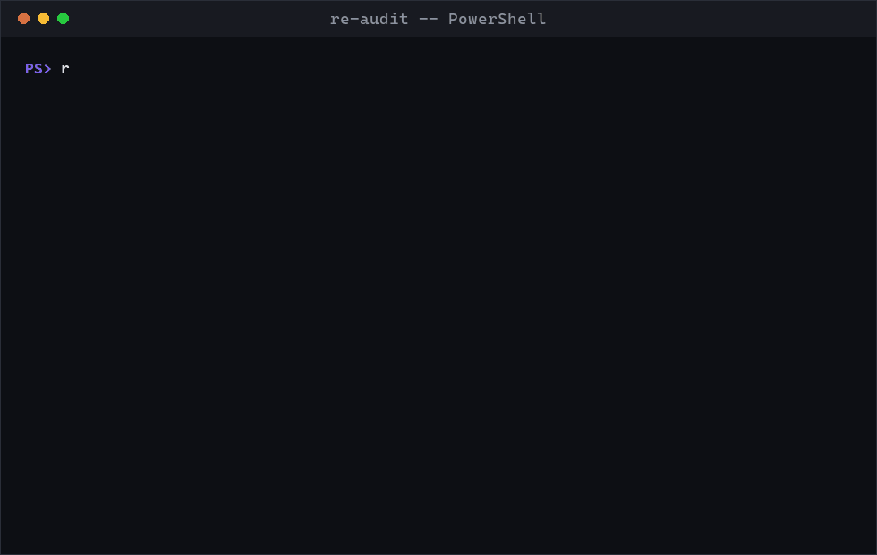
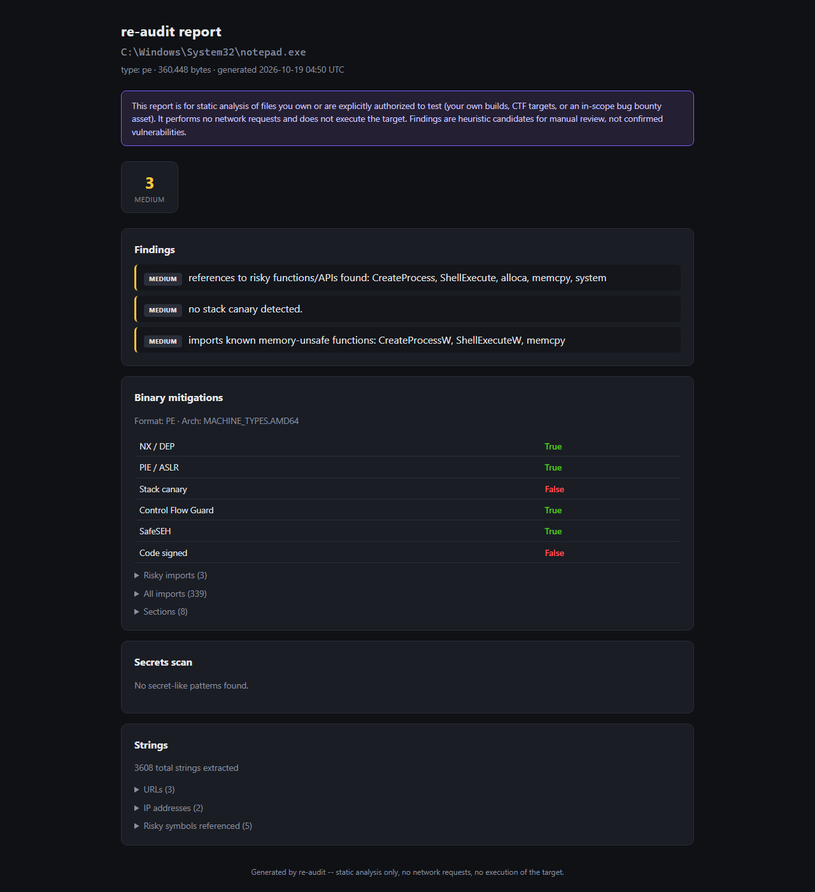

# re-audit

[](https://github.com/TLSRUF/re-audit/actions/workflows/ci.yml)
[](LICENSE)

Static, reverse-engineering-assisted vulnerability triage, as a CLI **and**
an MCP server so an AI agent (Claude Code, etc.) can drive it.

It extracts strings, flags hardcoded-secret patterns, checks ELF/PE/Mach-O
exploit mitigations, and audits Android APK manifests -- then hands back a
single structured report with a `summary_findings` list.



<details>
<summary>Full HTML report (click to expand screenshot)</summary>



</details>

Everything shown above is real output from this repo's own code, run
against `notepad.exe` and the synthetic secrets fixture in `tests/` --
nothing in these assets is staged or fabricated.

## Scope -- read this first

This tool is **static-analysis only**:

- It never sends a network request.
- It never executes, launches, or instruments the target.
- It only reads bytes from a local file you point it at.

That makes it safe to run on anything sitting on your disk. It does **not**
make it legal to run *against a service you don't own or aren't authorized
to test*. Before pointing this at anything:

- **Your own code/builds** -- always fine.
- **CTF binaries, crackmes, deliberately vulnerable apps** (Juice Shop,
  DVWA, HackTheBox/picoCTF targets) -- fine.
- **A real company's app or website** -- only if you have a signed
  authorization, or the target has a published bug-bounty / vulnerability
  disclosure program (HackerOne, Bugcrowd, or the vendor's own
  `security.txt` / bounty page) and your activity stays inside its stated
  scope and rules.
- If no scope or program exists, don't test it. Report findings only
  through the vendor's official security contact, or via a national CERT
  (e.g. KISA in Korea) if there's no direct channel. Never demand payment
  for a report you weren't invited to submit -- that can be read as
  extortion.

Findings this tool produces are **heuristic candidates for human review**,
not confirmed, exploitable vulnerabilities. Always verify manually before
reporting anything to a vendor.

## Install

```bash
pip install -e .
```

## CLI usage

```bash
re-audit scan ./my_app.apk               # full audit, human-readable
re-audit scan ./my_app.apk --json        # full report as JSON
re-audit scan ./binary.exe --out report.json
re-audit scan ./binary.exe --html report.html   # styled, shareable HTML report

re-audit strings ./binary.exe            # just string extraction
re-audit secrets ./binary.exe            # just secret-pattern scanning
re-audit binary ./binary.exe             # just exploit-mitigation checks
re-audit apk ./my_app.apk                # just APK manifest audit
```

## MCP server usage

Run directly:

```bash
re-audit-mcp
```

Or register it with Claude Code (`claude mcp add`) / your MCP client's
config, pointing it at `re-audit-mcp` (stdio transport). Exposed tools:

| Tool | Purpose |
|---|---|
| `detect_file_type` | Identify ELF / PE / Mach-O / APK / JAR by magic bytes |
| `scan_strings` | Extract + classify strings (URLs, IPs, paths, risky API names) |
| `scan_secrets` | Hardcoded credential/token/key pattern + high-entropy scan (redacted) |
| `scan_binary_mitigations` | NX, PIE/ASLR, RELRO, stack canary, CFG, risky imports |
| `scan_apk` | Debuggable/backup/cleartext flags, dangerous permissions, exported components |
| `full_audit` | Runs all of the above and merges into one report |

The server's instructions tell the connected agent to confirm the target
is in-scope before scanning and to present findings as unverified
candidates -- but that's a prompt-level nudge, not an enforcement
mechanism. The scope decision is still yours.

## What it checks

- **Strings**: URLs, IPs, filesystem paths, references to risky functions
  (`strcpy`, `system`, `eval(`, `pickle.loads`, etc.)
- **Secrets**: AWS/Google/Slack/GitHub key formats, PEM private key blocks,
  JWTs, generic password/API-key assignments, DB connection strings, plus
  high-entropy token detection for anything the regexes miss.
- **Binaries** (via [LIEF](https://lief.re/)): NX/DEP, PIE/ASLR, RELRO
  (ELF), stack canary, Control Flow Guard / SafeSEH (PE), Authenticode
  signature, and a curated list of memory-unsafe imports.
- **APKs** (via [androguard](https://github.com/androguard/androguard)):
  `debuggable`, `allowBackup`, `usesCleartextTraffic`, dangerous
  permissions, and exported activities/services/receivers/providers
  without `exported="false"`.

## Development

```bash
pip install -e .
pip install pytest
pytest tests/ -v
```

Tests run against real artifacts (`C:\Windows\System32\notepad.exe`) rather
than mocks, so CI runs on `windows-latest`. The APK analyzer's end-to-end
test needs a real debug `.apk` you own -- point `RE_AUDIT_TEST_APK` at one
locally to run it; it's skipped otherwise (no binary fixtures are committed
to keep the repo small).

To regenerate `examples/demo.gif`: `python scripts/make_demo_gif.py` (pure
Pillow, hand-renders the terminal frames -- no pty/ffmpeg dependency).

## License

MIT
